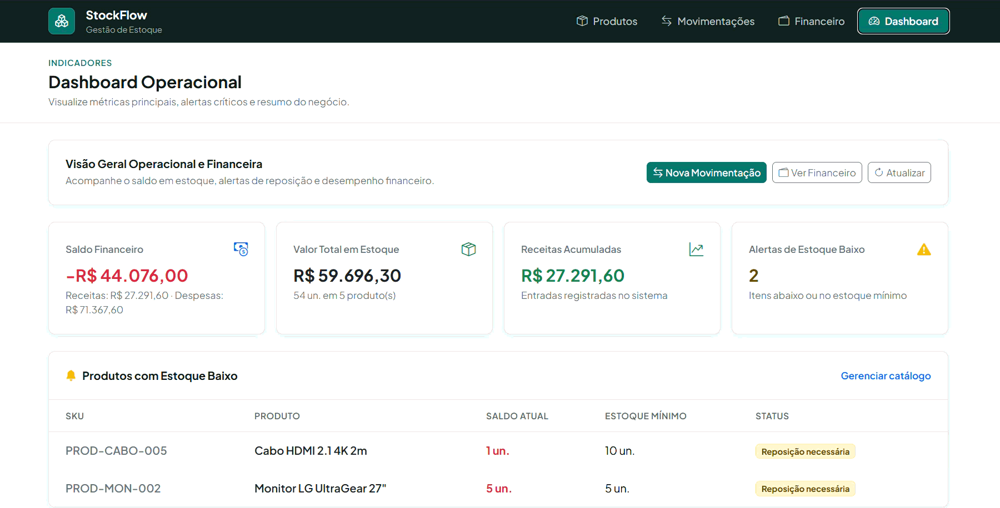

<h1 align="center">
   StockFlow ERP
  <br>
</h1>

<h4 align="center">Sistema de Gestão Financeira e Controle de Estoque Full-Stack</h4>

  

<p align="center">
 Aplicação full-stack para controle de catálogo, movimentações de estoque, lançamentos financeiros e indicadores operacionais, construída com foco em engenharia de software, automação de CI e boas práticas de portfólio.
</p>

<div align="center">

[](https://dotnet.microsoft.com/)
[](https://react.dev/)
[](https://www.typescriptlang.org/)
[](https://www.mysql.com/)
[](https://getbootstrap.com/)
[](https://www.docker.com/)
[](https://github.com/features/actions)
[](LICENSE)

</div>

---

##  Objetivos de Aprendizado

O **StockFlow** foi desenvolvido para simular o ciclo de vida completo do software dentro de um ambiente corporativo, extrapolando os requisitos padrão de projetos acadêmicos e focando em **padrões de mercado competitivos**.

* **Integração ponta a ponta**: Conexão entre interface em React + TypeScript, API REST em .NET e banco relacional MySQL (`stockflow_db`).
* **Processo Orientado a Git e Issues**: Gestão do repositório baseada em branches de funcionalidade (`feature/`, `fix/`, `docs/`), PRs revisados com checklists detalhados e rastreabilidade total de marcos (Milestones) e Issues no GitHub.
* **Fluxo de trabalho organizado no GitHub**: Branches temáticas, `PULL_REQUEST_TEMPLATE.md`, checklists por issue e pipelines dedicadas de CI (`backend-ci.yml` e `frontend-ci.yml`).
* **Resiliência a falhas e validação de dados**: Tratamento de valores nulos (`DBNull`) no acesso ao banco, validações de regras de negócio e feedback visual consistente com toasts e modais de confirmação.
* **Interface e experiência do usuário**: Componentes responsivos com Bootstrap 5, filtros combinados, projeção de saldo em tempo real e formatação monetária em `R$`.

---

##  Funcionalidades Principais

| Módulo | Tela | Principais Recursos |
| :--- | :--- | :--- |
| **Dashboard** | `/dashboard` | Resumo financeiro consolidado, indicadores em tempo real (total em estoque, receitas, despesas, saldo acumulado) e tabela de alertas de reposição para produtos com estoque igual ou abaixo do mínimo. |
| **Produtos** | `/produtos` | Catálogo completo com busca por SKU/Nome, filtro de ativos/inativos, cadastro/edição modal e toggle imediato de status com confirmação. |
| **Movimentações** | `/movimentacoes` | Registro de `ENTRADA` e `SAIDA`, visualização de saldo atual, estoque mínimo, saldo projetado e valor estimado em R$. Modal de confirmação para saídas e integração automática com o módulo financeiro. |
| **Financeiro** | `/financeiro` | Lançamentos de `RECEITA` e `DESPESA`, novos registros manuais com validações visuais em tempo real, badges de status/origem e tabela filtrável por intervalo de datas, categoria e tipo. |

---

##  Decisões Técnicas

###  Ausência de Autenticação / Login
Para manter o foco principal nas **regras do domínio ERP** (conciliação estoque-financeiro, cálculo de saldos em tempo real e integridade relacional), a camada de autenticação (JWT / OAuth2 / Identity) foi propositalmente definida fora do escopo desta versão inicial (*v1.0*).

> **Nota**: Toda a arquitetura foi desenhada para facilitar a acoplagem futura de um middleware de autorização sem impacto nos controllers ou repositórios de negócio existentes.

###  Tratamento Resiliente de Dados
No acesso ao MySQL via `MySqlConnector`, o repositório aplica verificações explícitas `IsDBNull()` em colunas como `origem`, `movimentacao_id` e `observacao`. Essa abordagem elimina o erro comum `InvalidCastException` ao consultar registros legado ou inserções originadas por gatilhos automáticos.

---

##  Testes e Qualidade de Código

A qualidade do repositório é mantida por meio de verificações automatizadas de compilação, análise estática e suíte de testes:

### 1. Testes Automatizados no Back-end (.NET)
Utiliza-se **FluentAssertions** para testes de unidade e verificação das regras de contrato e lógica dos repositórios/DTOs.
```bash
dotnet test src/back/StockFlow.Api.Tests/
```
### 2. Front-end (React + TypeScript + Vite)
Checagem estática com **ESLint** e build de produção:

```bash
cd src/front
npm run lint
npm run build
```

###  CI/CD com GitHub Actions
Os workflows em `.github/workflows/` automatizam as validações do projeto:
* **`backend-ci.yml`**: restauração de pacotes, build e testes do back-end.
* **`frontend-ci.yml`**: instalação de dependências, lint e build do front-end.

---

##  Estrutura do Repositório

```text
mini-erp-dotnet-react/
├── .github/
│   ├── workflows/
│   │   ├── backend-ci.yml
│   │   └── frontend-ci.yml
│   └── PULL_REQUEST_TEMPLATE.md
├── docs/
│   ├── imagens/
│   │   └── Arquitetura.jpg
│   └── videos/
│       └── demonstracao-stockflow.gif
├── src/
│   ├── back/
│   ├── db/
│   ├── front/
│   └── README.md
├── .gitignore
├── LICENSE
└── README.md
```

---

##  Instalação e Execução Local

### Pré-requisitos
* **.NET SDK**
* **Node.js** e **npm**
* **MySQL** ou **Docker**

### 1. Clonar o Repositório
```bash
git clone [https://github.com/SEU_USUARIO/mini-erp-dotnet-react.git](https://github.com/SEU_USUARIO/mini-erp-dotnet-react.git)
cd mini-erp-dotnet-react
```

### 2. Subir o Banco de Dados
Suba o MySQL via Docker (`src/db/docker-compose.yml`) ou execute os scripts em `src/db/scripts/` (`CREATE_SCHEMA.sql` e `SEED.sql`) na instância local.

### 3. Executar o Back-end
```bash
dotnet run --project src/back/StockFlow.Api/StockFlow.Api.csproj
```
Por padrão, a API responde em `http://localhost:5080`.

### 4. Executar o Front-end
```bash
cd src/front
npm install
npm run dev
```
Por padrão, a aplicação abre em `http://localhost:5173`.

---

## Sobre Mim

Desenvolvido por *Laura Morgado Bastos Gomes*
Estudante de *Sistemas de Informação - PUC Minas*.

### Conecte-se comigo

Você pode me encontrar nos canais abaixo:


[](https://www.linkedin.com/in/laura-morgado-bastos?)
[](https://github.com/lauramorgadobastos)
[](mailto:laura.bastosmorgado27@gmail.com)

---

##  Licença

Distribuído sob a licença **MIT**. Consulte o arquivo `LICENSE` para mais informações.

---

<div align="center">
  <sub>Desenvolvido por <b>Laura Morgado</b>.</sub>
</div>

