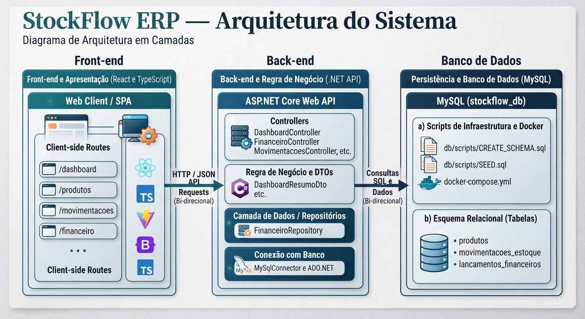

# StockFlow — Código-Fonte

Esta pasta contém os módulos principais do sistema **StockFlow** (`mini-erp-dotnet-react`):

* **`back/`**: API REST em **.NET** (`StockFlow.Api`) com controllers, DTOs, models e repositórios via `MySqlConnector`.
* **`db/`**: Estrutura do banco `stockflow_db` no **MySQL**, contendo `db/scripts/CREATE_SCHEMA.sql`, `db/scripts/SEED.sql` e `docker-compose.yml`.
* **`front/`**: Aplicação web em **React + TypeScript + Vite + Bootstrap** com as telas de **Dashboard**, **Produtos**, **Movimentações** e **Financeiro**.

---

## Arquitetura

O sistema segue uma arquitetura em camadas separando apresentação (React), regras/acesso a dados (.NET API) e persistência relacional (MySQL):



* **Front-end (`src/front`)**: Consome os endpoints REST via HTTP/JSON e gerencia navegação, filtros, validações, modals de confirmação e toasts de feedback.
* **Back-end (`src/back/StockFlow.Api`)**: Expõe os endpoints de dashboard, financeiro, movimentações e produtos, executando queries parametrizadas no MySQL.
* **Banco de Dados (`src/db`)**: Define o esquema em `db/scripts/CREATE_SCHEMA.sql`, popula dados iniciais em `db/scripts/SEED.sql` e permite subir o ambiente com `docker-compose.yml`.

### Módulos e Endpoints Principais

| Módulo | Rota no Front-end | Endpoints da API | Responsabilidade |
| :--- | :--- | :--- | :--- |
| **Dashboard** | `/dashboard` | `GET /api/dashboard/resumo`<br>`GET /api/dashboard/alertas-estoque` | Indicadores financeiros e de estoque, além dos alertas de estoque baixo. |
| **Produtos** | `/produtos` | `GET /api/produtos`<br>`POST /api/produtos`<br>`PUT /api/produtos/{id}`<br>`PATCH /api/produtos/{id}/status` | Cadastro, edição, busca, filtros e ativação/inativação de produtos. |
| **Movimentações** | `/movimentacoes` | `GET /api/movimentacoes`<br>`POST /api/movimentacoes` | Registro de entradas e saídas, projeção de saldo, filtros e integração financeira/estoque. |
| **Financeiro** | `/financeiro` | `GET /api/financeiro`<br>`POST /api/financeiro` | Resumo financeiro, criação de lançamentos manuais e filtros por período, categoria e tipo. |

---

## Estrutura de Pastas (`src/`)

```text
src/
├── back/
│   └── StockFlow.Api/
│       ├── Controllers/
│       ├── DTOs/
│       ├── Models/
│       ├── Properties/
│       └── Repositories/
├── db/
│   ├── scripts/
│   │   ├── CREATE_SCHEMA.sql
│   │   └── SEED.sql
│   ├── docker-compose.yml
│   └── README.md
└── front/
    └── src/
        ├── components/
        ├── pages/
        ├── routes/
        ├── services/
        └── types/
```

---

## Como Executar Localmente

### 1. Banco de Dados (MySQL)

Você pode subir o banco via Docker (se configurado em `src/db/docker-compose.yml`) ou executar os scripts diretamente no MySQL:

```bash
mysql -u root -p < src/db/scripts/CREATE_SCHEMA.sql
mysql -u root -p < src/db/scripts/SEED.sql
```

### 2. Back-end (.NET API)

Na raiz do repositório:

```bash
dotnet restore src/back/StockFlow.Api/StockFlow.Api.csproj
dotnet build src/back/StockFlow.Api/StockFlow.Api.csproj
dotnet run --project src/back/StockFlow.Api/StockFlow.Api.csproj
```

A API inicia por padrão em `http://localhost:5080`. Verifique a connection string (`DefaultConnection`) nos arquivos de configuração do projeto `StockFlow.Api`.

### 3. Front-end (React + Vite)

Em outro terminal:

```bash
cd src/front
npm install
npm run dev
```

Se necessário, configure `VITE_API_URL=http://localhost:5080` no ambiente ou no `.env` de `src/front`.

### Verificação de Build e Lint

```bash
dotnet build src/back/StockFlow.Api/StockFlow.Api.csproj

cd src/front
npm run build
npm run lint
```

---

## Decisões Técnicas e Manutenção

* **Leitura segura de campos nulos (`DBNull`) no back-end**: Campos opcionais ou preenchidos conforme a origem (`origem`, `movimentacao_id`) são verificados com `IsDBNull` antes de conversões tipadas, evitando `InvalidCastException`.
* **Separação entre schema e carga inicial**: `db/scripts/CREATE_SCHEMA.sql` estrutura o banco `stockflow_db` e `db/scripts/SEED.sql` aplica os dados iniciais.
* **Feedback visual no front-end**: Erros da API são tratados de forma padronizada e exibidos via toasts, com confirmação explícita em ações sensíveis.